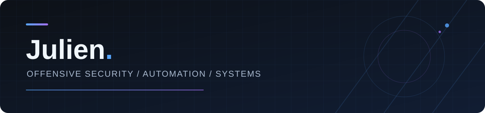

  

  <strong>Building practical tools. Understanding systems. Exploring security.</strong>

  <a href="#about-me">About</a> · <a href="#featured-projects">Projects</a> · <a href="#github-activity">Activity</a> · <a href="#tech-stack">Tech Stack</a>

---

### About Me

Hi, I'm **Julien**, a high school student based in **Berlin, Germany**, with a strong interest in **cybersecurity, software development, and computer systems**.

I started by exploring how technology works in practice: troubleshooting networks, writing scripts, and working with Linux and Windows systems. Over time, that curiosity grew into building my own tools and studying how applications communicate, fail, and can be secured.

I'm currently developing my skills through **independent projects and hands-on learning**, with a long-term goal of specializing in **web application penetration testing and offensive security**. I value understanding *why* something works, not just getting it to work.

### Featured Projects

**Vulnora** · *In development*  
An AI-assisted web application security testing tool. I'm working on bringing together web reconnaissance, testing workflows, and local AI assistance in a practical interface. It's my main security-focused project and an ongoing learning experience.

**CodexPi** · *Developer tooling*  
A project focused on making AI-assisted development workflows easier to manage and automate, including session handling and workflow reliability.

<!-- Add verified repository links to the project names when ready. -->

### GitHub Activity

  

### What I'm Working On

- **Web security:** strengthening my knowledge of enumeration, attack surfaces, and application vulnerabilities.
- **Vulnora:** developing an AI-supported toolkit for structured web security testing.
- **Automation:** creating Python tools and reliable services that simplify repetitive tasks.
- **Systems & networking:** working with Linux servers, network protocols, and real-world troubleshooting.

### How I Work

I prefer **practical experimentation and systematic problem-solving**: reproduce a problem, understand the underlying behavior, build a solution, and improve it through testing. My projects are both tools I want to use and opportunities to deepen my technical skills.

### Tech Stack

  
  
  
  

  
  
  
  
  
  
  

